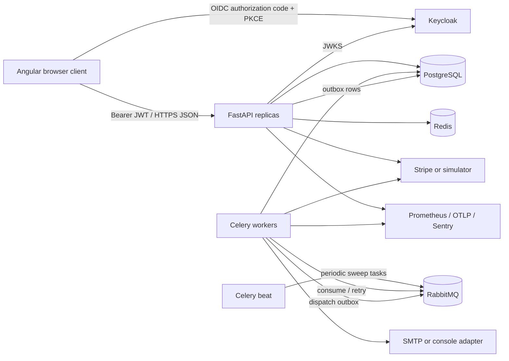

# Backend architecture

## Architectural style

The backend is a modular monolith. One codebase and one PostgreSQL schema contain product, customer, inventory, order, payment, refund, and fulfillment modules. API and Celery worker processes reuse the same models and transactional services.

This is not a “single process” design. API replicas, worker replicas, beat, Keycloak, PostgreSQL, RabbitMQ, Redis, and payment providers are independent runtime components.



## Request layering

```text
HTTP router
  -> authentication/authorization dependency
  -> Pydantic request validation
  -> domain service transaction
  -> SQLAlchemy models/PostgreSQL
  -> Pydantic response serialization
```

- Routers translate HTTP concerns and apply role/ownership boundaries.
- Schemas validate transport data and prevent ORM entities becoming the external contract accidentally.
- Services own transaction boundaries, row locks, state transitions, and external integration orchestration.
- Models define persistence shape and database constraints.
- Integrations normalize external provider behavior.
- Workers invoke the same services from durable queues.

Routers must not duplicate inventory or payment state transitions.

## Source of truth by concern

| Concern | Source of truth |
|---|---|
| Products, stock, orders, payments, refunds, outbox | PostgreSQL |
| Identity, credentials, role assignment | Keycloak |
| Durable job delivery | RabbitMQ |
| Shared rate-limit counters | Redis |
| Card/payment network outcome | Selected payment provider |
| Logs, traces, metrics | External observability backends |

Redis is not used as the authoritative inventory store. Losing Redis temporarily affects rate limiting or task results, not order correctness.

## API and workers

FastAPI uses synchronous SQLAlchemy sessions and regular `def` handlers. FastAPI runs regular handlers in its threadpool, so blocking database calls do not block the event loop. Each request gets one session that is always closed.

Celery workers use the same synchronous session factory. External provider calls happen after committing durable intent and outside long-running PostgreSQL transactions.

Celery beat only schedules sweeps. Individual payment deadlines remain persisted in PostgreSQL, so restarting beat does not erase deadlines.

## Authentication and authorization

1. Angular redirects to Keycloak using authorization code + PKCE.
2. Keycloak returns an access token with issuer, subject, audience, expiry, and roles.
3. FastAPI fetches signing keys from JWKS and validates RS256 signature, issuer, audience, expiry, issued-at, and subject.
4. Role dependencies enforce customer, operator, or admin access.
5. Customer queries also filter by local `Customer.id`; role checks alone are not object-ownership checks.

The local `Customer` record does not store a password. It maps the immutable Keycloak subject to OMS-owned addresses and orders.

## Reliability patterns

### Transactional outbox

Domain changes and an `OutboxEvent` are committed in one PostgreSQL transaction. A worker claims rows with `FOR UPDATE SKIP LOCKED`, publishes a task, and marks publication. Publication is at-least-once: consumers must tolerate duplicates.

After ten publishing failures an event is marked dead-lettered for operator investigation.

### Webhook inbox

Stripe event IDs are unique in `WebhookInbox`. Inserting the inbox row and applying the payment transition occur in the same transaction. Duplicate deliveries are acknowledged without reapplying stock or payment effects.

### Provider idempotency

The OMS stores a provider idempotency key before making an external call. Retrying after a timeout uses the same key. The customer-facing idempotency key and provider key are intentionally different.

### Reconciliation

Uncertain does not mean failed. Pending payments retain reservations while workers query the provider using exponential backoff. After 24 hours automatic scheduling stops and the record remains in the review queue.

## Deployment model

Stateless components can scale horizontally:

- FastAPI API
- Celery workers
- Angular/Nginx

Stateful dependencies should generally be managed production services:

- PostgreSQL with backups and point-in-time recovery
- RabbitMQ with durable/quorum queues
- Redis with authentication/TLS appropriate to its role
- Keycloak backed by a production database and redundant instances

Compose is a learning environment, not a high-availability topology.
