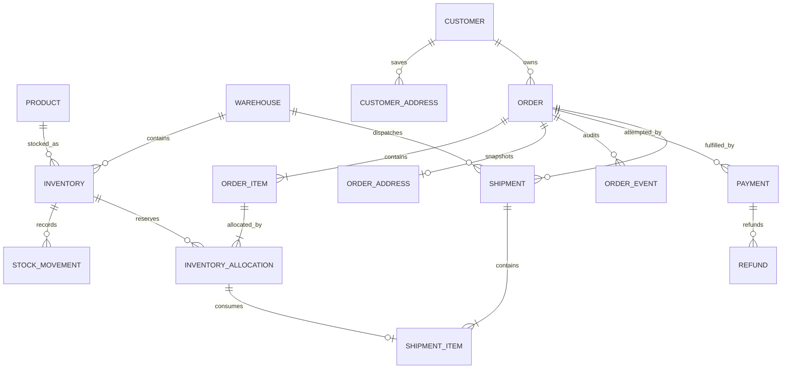
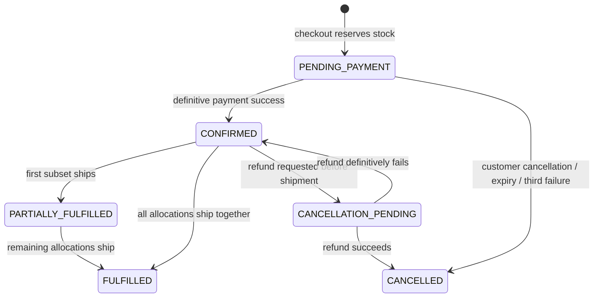
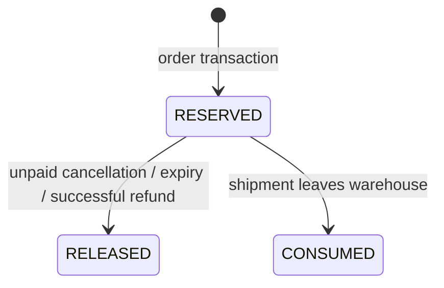
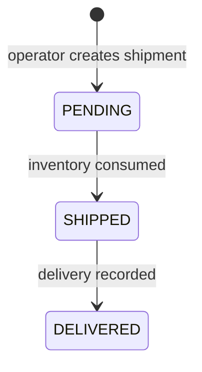
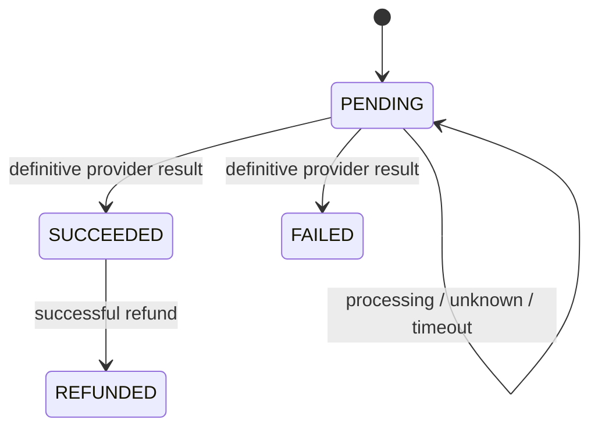
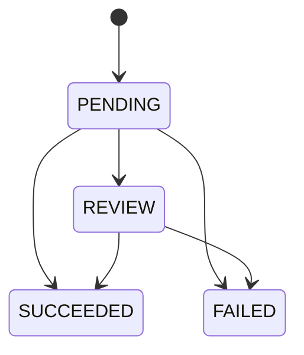

# Domain model and invariants

## Entity map



## Product

A product is the commercial definition: SKU, name, description, price, and active flag. `OrderItem.unit_price` snapshots the purchase-time price so later catalog edits do not change historical totals.

Invariants:

- SKU is unique.
- Price is positive in the API.
- Inactive products remain available to historical orders but cannot enter new orders.

## Warehouse and inventory

`Warehouse.priority` controls deterministic allocation. Smaller values are considered first; warehouse ID breaks ties.

An `Inventory` row is unique for `(warehouse_id, product_id)`.

```text
available = quantity_on_hand - quantity_reserved
```

- `quantity_on_hand` is physical stock believed to be in the warehouse.
- `quantity_reserved` is the subset promised to active orders but not shipped.
- Available can never be negative.
- Reserved can never be negative or exceed on-hand.

Database check constraints enforce those arithmetic rules even if application code is bypassed.

### Stock movement

`StockMovement` is an append-only explanation of physical on-hand changes:

- `RECEIPT`: new stock entered.
- `ADJUSTMENT`: an audited operator correction.
- `SHIPMENT`: physical stock left.

Reservations are represented by `InventoryAllocation`, not by a physical stock movement.

## Customer and addresses

`Customer.keycloak_subject` maps OMS data to an immutable identity-provider subject. Email and display name are synchronized profile data, not credentials.

Saved addresses belong to one customer. An order receives a separate `OrderAddress` snapshot. Editing or deleting the saved address cannot rewrite an existing order.

PII must not appear in logs, metrics, tracing attributes, or payment metadata.

## Order and item

An order has one currency, a price snapshot in each item, and an exact decimal total. Duplicate product lines in a request are aggregated before stock is checked.



Shipped orders are not cancellable. Returns/exchanges are a separate future bounded context; the system does not silently pretend cancellation can reverse a physical shipment.

`OrderEvent` is append-only operational history. It is an audit timeline, not full event sourcing; current entity rows remain the source of state.

## Inventory allocation

An allocation links an order item to one warehouse inventory row and exact quantity.



Allocation policy:

1. Aggregate requested quantity by product.
2. Consider active warehouse inventory ordered by product, warehouse priority, warehouse ID, inventory ID.
3. Take as much as possible from each row.
4. Split only when an earlier warehouse cannot satisfy the remaining quantity.
5. Reject the whole order if any product remains short.

The order transaction validates every product before reserving any. It never intentionally creates a partial order.

Current shipment granularity consumes complete allocation rows. Operators can make partial order shipments by selecting a subset of allocations, including warehouse splits. Splitting one allocation row into several shipments is not implemented yet.

## Shipment

A shipment belongs to one order and one warehouse. Its allocation IDs must:

- belong to the same order,
- remain `RESERVED`,
- belong to one warehouse,
- not already be assigned/consumed incorrectly.



Creating a shipment does not change stock. Marking it shipped atomically decrements on-hand and reserved, marks allocations consumed, writes stock movements, updates order fulfillment status, adds an order event, and writes an outbox event.

## Payment

Each payment row is one provider attempt.



Rules:

- Maximum three attempts per order.
- One uncertain pending attempt blocks another attempt.
- A failed attempt can be retried for five minutes.
- A third definitive failure cancels the order and releases stock.
- Provider uncertainty retains stock and enters reconciliation.
- Payment success confirms the order but does not reduce physical stock.
- Client and provider idempotency keys are unique.

## Refund

A refund belongs to a successful payment. Only paid orders without consumed allocations enter refund cancellation.



Successful refund:

- marks payment `REFUNDED`,
- releases reserved allocations,
- marks order `CANCELLED`,
- writes order/outbox events.

Failed refund restores the order to `CONFIRMED`; uncertain refund remains in review.

## Integration records

- `OutboxEvent`: reliable bridge from committed domain state to asynchronous work.
- `WebhookInbox`: deduplicates Stripe webhook event IDs.
- `SimulatorTransaction`: shared local provider state, including operation, amount, currency, status, and provider reference.

These tables are shared in PostgreSQL so horizontally scaled API and worker processes see the same state.
