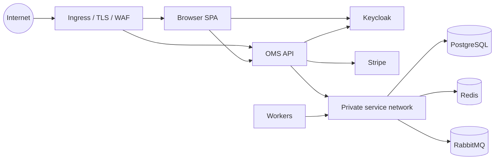

# Backend security model

This is a design-level threat model, not a completed penetration test.

## Assets

- customer identity and address PII;
- catalog and pricing;
- physical inventory and allocations;
- order/payment/refund/fulfillment history;
- Stripe, database, broker, SMTP, and identity credentials;
- audit and observability data.

## Trust boundaries

Production must terminate TLS at a trusted ingress/load balancer and restrict stateful services to private networks.

## Authentication threats

Controls:

- only RS256 accepted;
- signature key fetched from configured JWKS;
- exact issuer and audience validation;
- expiry, issued-at, issuer, and subject required;
- Keycloak authorization code + PKCE for browser;
- local password grant documented as learning-only;
- no OMS password storage.

Production requirements:

- MFA/conditional access according to risk;
- secure Keycloak administration and backup;
- short access-token lifetime and appropriate refresh rotation;
- remove demo users/password grant;
- TLS for issuer/JWKS;
- alert on repeated invalid token/audience.

## Authorization and horizontal access

Roles answer “what class of operation.” Query ownership answers “which object.”

- customer orders/payments are filtered by local customer/subject;
- addresses require customer ownership;
- operator/admin can inspect operational scope;
- admin alone mutates catalog/warehouse definitions and arbitrary stock adjustments;
- unauthorized ownership uses 404 where appropriate to avoid existence disclosure.

Every new endpoint must document role and ownership separately.

## Payment threats

Controls:

- secret key backend-only;
- raw-body signed webhook validation;
- unique webhook event inbox;
- separate client/provider idempotency;
- amount copied from trusted order, never browser amount;
- safe OMS IDs only in provider metadata;
- uncertainty preserved instead of double-charge retry;
- refunds restricted to paid unshipped orders.

Never log client secret, API key, webhook secret, token, or full provider payload.

PCI scope still depends on frontend integration and operational architecture. Use Stripe Elements/hosted fields so raw card data does not pass through OMS servers.

## Inventory and business abuse

Controls:

- server calculates price and availability;
- row locks/constraints prevent oversell races;
- role-gated reason-coded adjustments;
- body limits and Redis mutation limits;
- append-only order/stock events.

Future controls can include fraud/risk scoring, velocity rules by verified account, order value limits, and approval for large stock adjustments.

## Injection and data validation

- Pydantic validates lengths, positivity, country/currency forms, and pagination bounds.
- SQLAlchemy parameterizes normal queries.
- no user data is interpolated into SQL.
- Stripe search interpolation uses an OMS-generated random key, not raw user input.
- output schemas prevent accidental ORM/provider serialization.

## PII and privacy

- address snapshot is required for historical fulfillment;
- logs/traces must redact addresses, phone, email, tokens;
- backups and observability access require least privilege;
- retention/deletion policy is organization/jurisdiction-specific and not implemented automatically;
- Keycloak account deletion does not automatically delete legally retained orders.

## Rate limiting

Mutation requests use shared Redis counters. Keys hash authorization token or client address plus route/time window. Limits are stricter for payment paths.

Current behavior fails open if Redis commands fail, while readiness becomes unhealthy. A higher-risk environment may fail payment creation closed but must balance outage behavior.

Trusted proxy configuration is essential before using forwarded client addresses for security decisions.

## Secrets

Local examples are not secrets. Production values must come from an external secret manager or Kubernetes Secret reference integrated with one.

- never commit `.env`;
- never place secrets in image layers or frontend runtime config except publishable keys;
- rotate by provider-specific procedure;
- use separate credentials per environment;
- restrict DB role privileges;
- use TLS to PostgreSQL, Redis, RabbitMQ, Keycloak, SMTP, Stripe, OTLP/Sentry.

## Containers and Kubernetes

Backend image runs non-root. Production chart should additionally use:

- read-only root filesystem;
- dropped Linux capabilities;
- seccomp runtime default;
- resource requests/limits;
- network policies;
- dedicated service accounts with no unnecessary token mount;
- signed/scanned images and SBOM;
- ingress TLS and secure headers.

## Audit limitations

`OrderEvent` and `StockMovement` provide operational audit, but database administrators can modify rows. Regulatory tamper evidence may require append-only external audit export, restricted DB roles, retention locks, and signed records.

## Security verification checklist

- dependency and container scan;
- secret scan;
- static analysis;
- authorization matrix tests;
- horizontal-access tests;
- webhook signature/replay tests;
- body/rate limit tests;
- TLS/headers scan;
- Keycloak realm review;
- Stripe integration review;
- backup access/restore review;
- penetration test before real customer/payment data.
