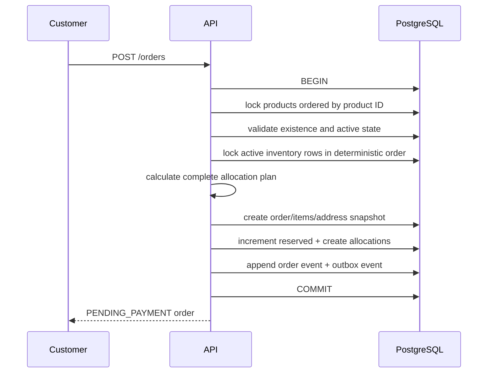
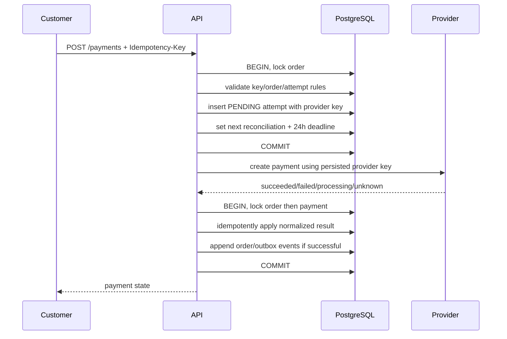
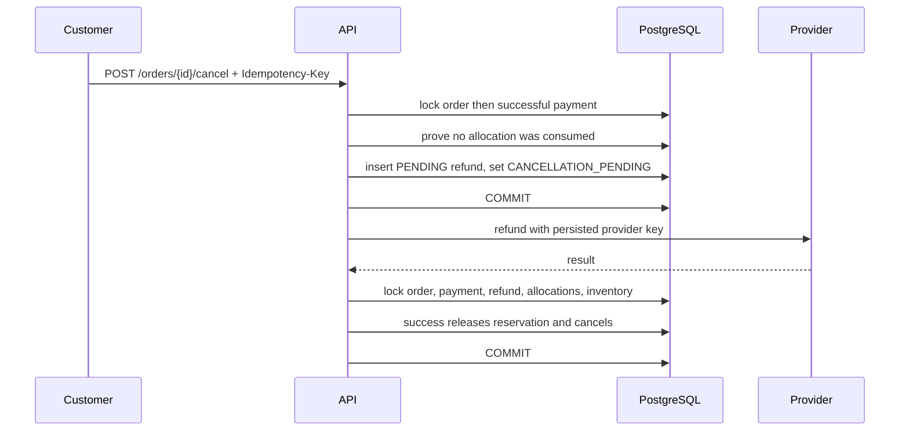
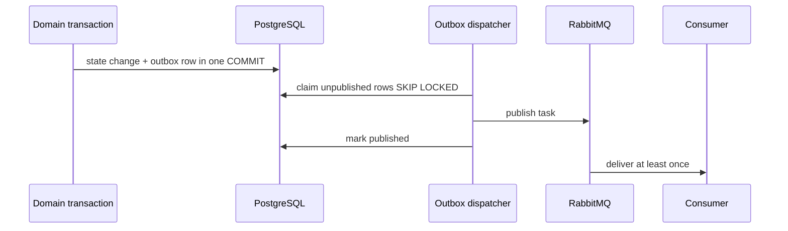

# Transaction order and failure recovery

This document describes commit boundaries. A “transaction” here is a PostgreSQL transaction through one SQLAlchemy `Session`.

## 1. Checkout and allocation



Failure behavior:

- Missing/inactive product or insufficient aggregate stock raises before any commit.
- Any exception rolls back order, items, reservations, allocations, event, and outbox together.
- Two checkouts for the same inventory serialize on row locks. The second recalculates availability after the first commits.
- API process death before commit leaves no order and no reservation.
- API process death after commit leaves a valid pending order. The reservation-expiry worker can later cancel it.

## 2. Payment creation: durable intent before external side effect

Payment uses three phases because PostgreSQL cannot atomically commit with Stripe or another provider.



### Crash matrix

| Crash point | Durable state | Recovery |
|---|---|---|
| Before phase-one commit | No provider call; no payment row | Client safely retries |
| After phase-one commit, before provider call | Pending attempt already scheduled | Reconciler queries; provider may return unknown |
| During provider call | Provider may or may not have charged | Reconciler uses same provider key; never assumes failure |
| Provider succeeded, API died before phase-three commit | Pending attempt remains | Simulator finds key; Stripe searches persisted key metadata |
| After phase-three commit, before response | Final state committed | Repeated client key returns same payment |
| Duplicate webhook | Inbox unique event ID | Duplicate acknowledged without reapplying transition |

The provider call is intentionally outside an open database transaction. Holding an order lock during network I/O would increase lock duration, pool occupancy, deadlocks, and tail latency.

## 3. Applying a provider result

All synchronous responses, automatic reconciliation, and Stripe webhooks normalize to one transition function:

1. Read payment to discover order ID.
2. Lock order.
3. Lock payment.
4. Return immediately if payment is no longer pending.
5. Save provider reference when present.
6. Apply one branch:
   - processing/unknown: retain reservation and schedule reconciliation;
   - failed: open retry window or cancel/release on third failure;
   - succeeded: require order still pending, then confirm and emit event/outbox;
   - unrecognized: retain pending and require review.
7. Commit atomically.

If a successful provider result arrives after the order was cancelled, the system does not reconfirm it or consume inventory. It flags the payment for review because money and order state disagree.

## 4. Reconciliation

Celery beat periodically enqueues the sweep:

1. Select pending, review-required payments whose `next_reconciliation_at` is due.
2. Read provider key/reference.
3. Call provider without holding a database lock.
4. Call the common payment transition under order-then-payment locks.
5. For uncertain results, increment attempts and schedule exponential backoff with jitter.
6. At the persisted 24-hour deadline, stop automatic scheduling and retain review status.

Provider lookup exceptions update the review reason and schedule another attempt if still before the deadline.

The reconciliation deadline is an escalation deadline, not permission to mark a charge failed. A timeout cannot prove no money moved.

## 5. Unpaid cancellation and reservation expiry

```mermaid
sequenceDiagram
    participant W as API/expiry worker
    participant P as PostgreSQL

    W->>P: BEGIN, lock order
    W->>P: lock reserved allocations ordered by inventory ID
    W->>P: lock inventories ordered by ID
    W->>P: validate every reserved quantity
    W->>P: decrement reserved; mark allocations RELEASED
    W->>P: set CANCELLED + append event
    W->>P: COMMIT
```

Validation happens before any row is changed. A detected inconsistency rolls back everything for operator investigation.

## 6. Paid cancellation and refund



Crash recovery:

- Refund intent and provider key commit before provider call.
- If the provider reference was not saved, reconciliation repeats refund creation with the same provider idempotency key.
- If a provider reference exists, reconciliation retrieves it.
- Uncertainty leaves `CANCELLATION_PENDING` and refund `REVIEW`; it does not release stock until refund success.

## 7. Shipment

Creating a shipment locks the order, then selected allocations. All allocations must be reserved and from one warehouse.

Marking shipped:

1. Read shipment to discover order.
2. Lock order.
3. Lock shipment.
4. Lock allocations ordered by inventory ID/allocation ID.
5. Lock inventories ordered by ID.
6. Validate all allocation, reserved, and on-hand quantities.
7. Decrement reserved and on-hand.
8. Mark allocations consumed and shipment shipped.
9. Append stock movements and order/outbox events.
10. Set order partially fulfilled or fulfilled.
11. Commit.

No physical quantity changes at shipment creation. A failure before the ship commit leaves a pending shipment and unchanged stock.

## 8. Outbox delivery



There is still a small duplicate window: the process can publish and die before marking the row. That is why consumers must be idempotent. There is no loss window between domain commit and outbox creation because they share one transaction.

Failed publications back off and are dead-lettered after ten attempts.

## 9. Webhook transaction

1. Verify Stripe signature over raw request bytes.
2. Insert unique event ID and raw normalized payload.
3. Resolve payment by provider reference.
4. Apply common payment transition.
5. Commit payment and inbox insertion together.
6. Mark inbox processed.

If the first commit succeeds but the processed timestamp commit fails, the payment transition is still correct. The inbox row may appear unprocessed operationally, but duplicate delivery cannot reapply payment effects.
